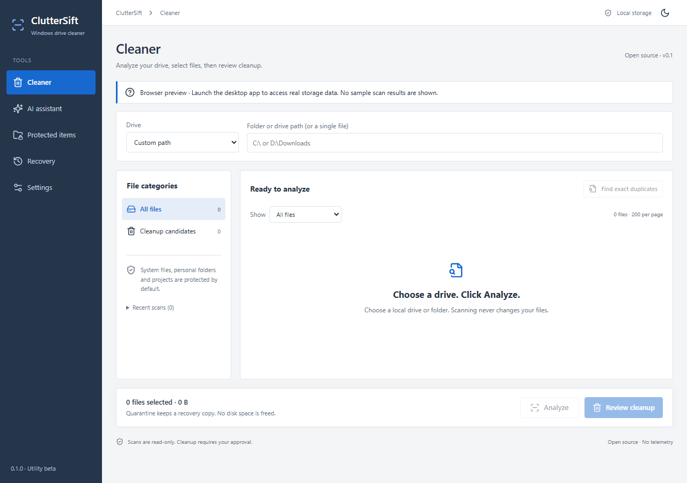

# ClutterSift

An open-source Windows storage utility for finding large files, reviewing duplicates, and quarantining eligible temporary files, with optional AI guidance.

**Experimental beta (0.1.0).** Quarantine keeps files for recovery and **does not free disk space**. Recycle Bin integration and permanent deletion are not implemented.



_Browser preview; native storage access is disabled and no sample scan results are shown._

## Features

- Read-only scans of local drives, folders, or files, with category filters and duplicate analysis.
- Built-in protection rules plus custom protected paths and scan exclusions.
- Cleanup previews, explicitly approved quarantine, and confirmed restore without overwriting.
- Offline guidance, optional local Ollama, or opt-in OpenRouter cloud AI.
- Light, dark, and system themes. No telemetry or analytics.

Currently, only `.tmp` files directly inside the OS temporary folder, older than seven days and allowed by protection rules, can be quarantined. Other categories and duplicate matches are analysis-only. Quarantine requires the same volume; restore files before removing app data or uninstalling.

## Windows setup

Build and run from source on **Windows 10/11 x64**. Install these prerequisites:

- Git and Node.js 24 LTS.
- Stable Rust with the MSVC toolchain (`rustup default stable-msvc`).
- Visual Studio 2022 Build Tools: select **Desktop development with C++** and a Windows SDK.
- Microsoft Edge WebView2 Runtime.

Then open PowerShell:

```powershell
git clone https://github.com/colbster255/ClutterSift.git
cd ClutterSift
npm ci
npm run tauri -- dev
```

To build an installer:

```powershell
npm run desktop:build
```

Find it in `src-tauri/target/release/bundle/nsis/`. Use this build command for distributable artifacts; it checks for embedded private development paths. Builds are currently unsigned.

## Use it

1. Start with a test folder containing copies of files. In **Cleaner**, choose a drive, folder, or file and click **Analyze**.
2. Review categories and selections, then click **Review cleanup**. The preview changes no files; a separate confirmation authorizes quarantine.
3. Use **Recovery** to review outcomes and confirm restores. Add rules under **Protected items** and save preferences under **Settings**.

## Optional AI setup

Scanning works without AI. Keep the default **Offline** provider to use it without a model or account.

### Local: Ollama

1. Open **Settings → AI provider → Ollama**.
2. Click **Install Ollama & download model** and review the linked software/model terms. Setup uses Windows Package Manager (`winget`) and downloads `qwen2.5:1.5b` (about 1 GB); allow at least 4 GB for Ollama plus model storage.
3. Wait for setup to finish. It verifies the model and saves the provider automatically. Use the connection check or in-app manual instructions if setup fails.

Setup starts Ollama locally when needed. Cancellation keeps installed software and model data; a separate installer may finish. Existing Ollama services keep their configuration—see [privacy and local-service configuration](docs/PRIVACY.md). Full automated installation and live inference still need verification; see [validation](docs/VALIDATION.md).

### Cloud: OpenRouter

1. Create an [OpenRouter account](https://openrouter.ai/) and add credits if your chosen model requires them.
2. [Create an API key](https://openrouter.ai/settings/keys) with a spending limit.
3. In **Settings**, select **OpenRouter** and enter a model ID that supports [structured outputs](https://openrouter.ai/docs/guides/features/structured-outputs).
4. Save the key to Windows Credential Manager, enable cloud consent, and click **Save preferences**.
5. Open **AI assistant** and submit a goal.

Your typed goal is sent verbatim, along with limited candidate IDs, categories, and sizes. File contents, filenames, and paths are not sent. Keep private information out of goals.

## Contributing and details

See [contributing](CONTRIBUTING.md), [architecture](docs/ARCHITECTURE.md), [privacy](docs/PRIVACY.md), [security](SECURITY.md), and [testing and limitations](docs/VALIDATION.md).

MIT licensed, provided **as is, without warranty**. Users are responsible for their choices and backups. Test cleanup only against synthetic fixtures; never post private inventories, paths, or keys in issues.
